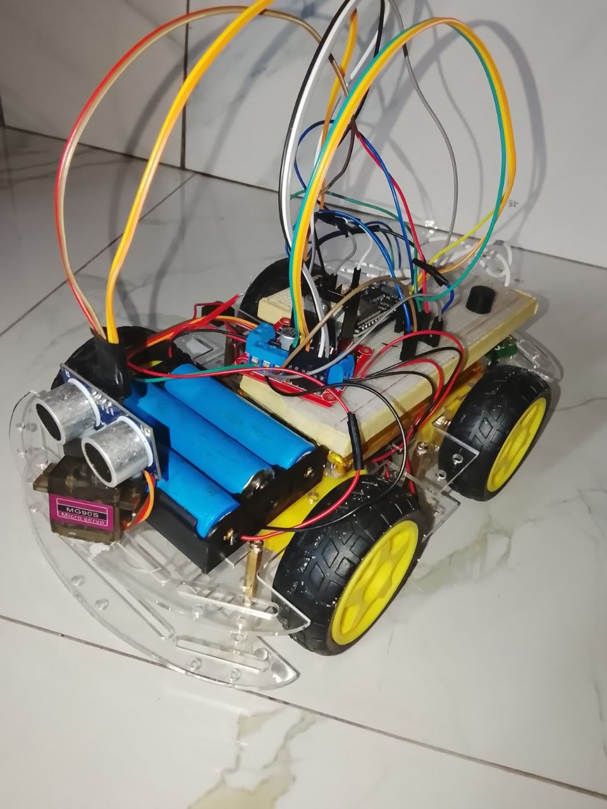
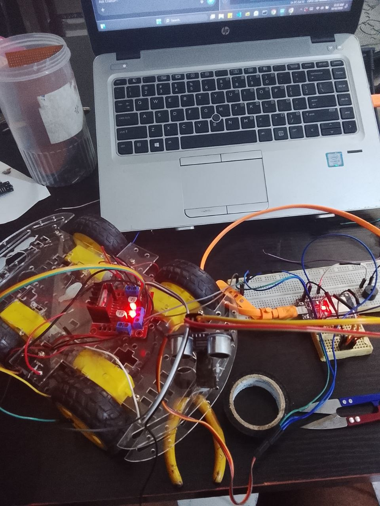

# ESP32 Obstacle-Avoiding Robot 🤖

An autonomous mobile robot built with an ESP32, an HC-SR04 ultrasonic sensor, a servo motor, and an L298N motor driver. The robot measures the distance to obstacles, scans its surroundings, and chooses a direction to navigate around them.

## Project Overview

This project explores embedded systems, sensor integration, motor control, and autonomous navigation using the ESP32 microcontroller.

The ultrasonic sensor measures the distance to obstacles. A servo motor rotates the sensor to scan different directions, while the ESP32 processes the readings and controls the DC motors through the L298N motor driver.

## Project Gallery

### Completed Robot

### Electronics and Wiring

### Development Process

## Components Used

- ESP32 DevKit (ESP32-WROOM-32)
- HC-SR04 ultrasonic distance sensor
- Servo motor
- L298N dual H-bridge motor driver
- Four TT DC geared motors
- Robot chassis and wheels
- Three Li-ion cells for the motor supply
- Separate power supplies for the ESP32 and servo
- Resistors for the ultrasonic sensor's Echo voltage divider
- Jumper wires and supporting hardware

## Pin Connections

| Component | Signal | ESP32 GPIO |
|---|---|---:|
| HC-SR04 | TRIG | 5 |
| HC-SR04 | ECHO | 18 |
| Servo | Signal | 13 |
| L298N | ENA | 25 |
| L298N | IN1 | 27 |
| L298N | IN2 | 14 |
| L298N | ENB | 26 |
| L298N | IN3 | 23 |
| L298N | IN4 | 19 |

**Important:** The HC-SR04 Echo pin is connected to GPIO 18 through a voltage divider to reduce the signal voltage to a level suitable for the ESP32.

## How It Works

1. The ultrasonic sensor measures the distance to an obstacle in front of the robot.
2. If the path is clear, the robot moves forward.
3. When an obstacle is detected, the robot stops and scans alternative directions by rotating the sensor with the servo.
4. The ESP32 compares the measured distances and selects a direction.
5. The motor driver controls the DC motors to execute the movement.

## Power and Safety

- The motors are powered through the motor driver's motor supply input.
- The ESP32 and servo use separate power supplies.
- The grounds of the ESP32, sensor, servo supply, and motor driver logic must share a common reference where required by the circuit.
- The HC-SR04 Echo signal uses a voltage divider because the ESP32 GPIO pins are not 5 V tolerant.
- Verify the battery voltage, regulator ratings, and motor-driver limits before powering the circuit.

**Battery note:** Three Li-ion cells in series can reach 12.6 V when fully charged. Use a suitable charger and verify that every component and supply input can safely handle its voltage.

## Challenges and Lessons Learned

During development, I worked through issues involving:

- Ultrasonic sensor voltage compatibility with the ESP32
- Reliable distance measurement and servo scanning
- Motor direction and movement control
- Interactions between servo timing and ESP32 motor PWM
- Separate power supplies and common grounding
- Hardware testing and systematic debugging

These challenges helped me develop practical experience in embedded programming and electronics troubleshooting.

## Future Improvements

- Add a wiring diagram and circuit layout
- Include photos and a demonstration video
- Improve navigation and obstacle-selection logic
- Add wireless manual control

## Author

**Dev-jr44**

Built as a hands-on mechatronics and embedded-systems project.
